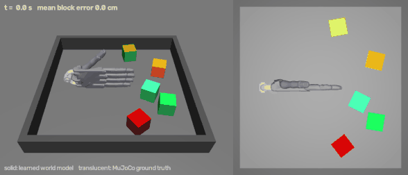
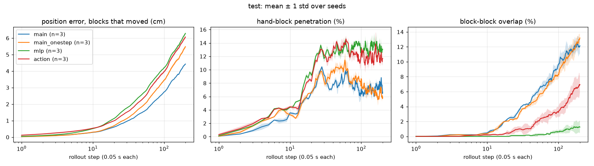
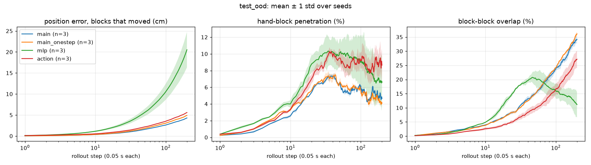
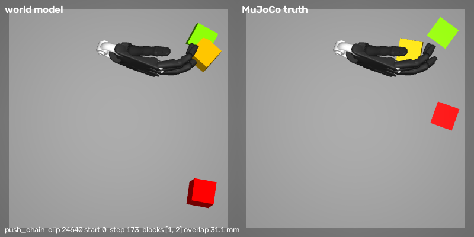
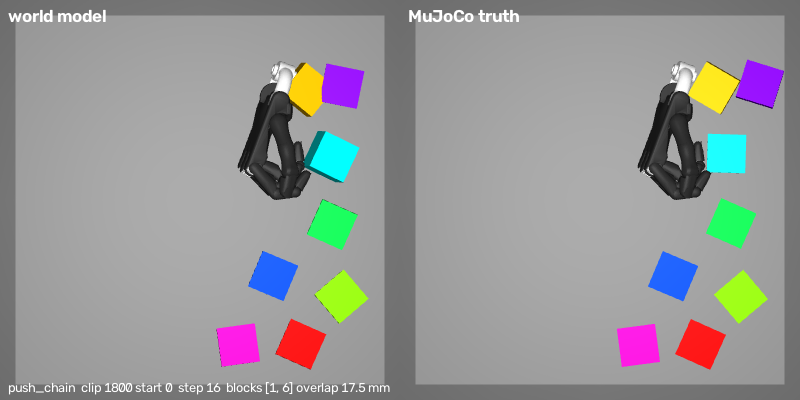

# hand-wm: a learned world model for five-finger hand–object interaction



*Held-out test clip, 10 s rollout. **Solid** blocks: the learned world model (no physics engine
involved). **Translucent** blocks and hand: MuJoCo ground truth for the same hand commands.
Full-quality video: [docs/demo.mp4](docs/demo.mp4).*

**hand-wm** trains an action-conditioned world model that replaces MuJoCo's hand–block contact
physics for a five-finger hand. The model is driven by the same 9 control numbers a camera or a
sensor glove produces (palm x, y, yaw, roll and one bend value per finger) and predicts how up to
8 blocks on a table move when the hand pushes, pokes, sweeps or pinches them. MuJoCo generates
the training data and serves as the answer key: every prediction is graded against the true
physics with a collision-based checker (position error, hand-through-block, block–block overlap,
teleporting).

## Real-hand control

The world model only ever sees the 9 control numbers (turned into 21 hand keypoints by a
block-free replay of the hand), so any input device that produces them can drive it.

| input | provides | status |
|---|---|---|
| webcam + MediaPipe hand landmarks | all 9: palm x, y (palm centre in the image), yaw (wrist→middle-finger direction, 2× gain), roll (palm normal), 5 finger bends (joint curls); calibrated to an open hand with `C` | working (~30 fps): launchers `6` (MuJoCo) and `11` (learned world) |
| wearable glove: BNO085 IMU | wrist yaw and roll | hardware acquired, being integrated |
| wearable glove: 5 flex sensors via MCP3008 ADC on a Raspberry Pi Pico | 5 finger bends | hardware acquired, being integrated |
| (glove mode) webcam | palm position | camera stays in the loop for x, y |

The model was trained only on scripted random hands in simulation, so real-hand control is also a
test of generalisation to human motion. Planned evaluation: record real-hand control sequences,
replay them in MuJoCo for ground truth and report the same metrics as below.

## Method

**Simulation and data.** A free-floating Shadow Hand ([MuJoCo Menagerie](https://github.com/google-deepmind/mujoco_menagerie))
whose finger joints are coupled so that one bend value drives each finger, plus 1–8 coloured
blocks in a walled arena. A scripted random hand (random pushes and wandering, four labelled hand
shapes plus 30 % freely bending fingers, palm roll from −100° to +100°) produced 30,000 clips of
12.8 s (256 steps of 0.05 s). Contacts were tuned so that true MuJoCo contacts overlap by at most
1.45 mm (hand–block) and 1.11 mm (block–block) at the 99.99th percentile; the 9 clips with any
anomaly are excluded. The model's hand input is a *block-free replay* of the commands, so it
cannot read block positions off a hand that was pushed back by them.

**Model.** An object-level Transformer encoder (4 layers, width 128, 4 heads, ≈0.8 M parameters).
Tokens: one per block (position, orientation quaternion, linear and angular velocity, in the table
frame) and 21 hand-keypoint tokens (each keypoint's position and its displacement over the step,
with a learned keypoint-index embedding). There is no positional encoding across blocks, so the
block count can vary. Each block token predicts its own change over 0.05 s (position delta and
rotation vector); hand tokens produce no output.

**Training.** Stage 1: one-step prediction from noisy inputs (GNS-style input noise, target = true
next state), 30k steps. Stage 2: rollout fine-tuning, feeding the model's own predictions back for
8, then 16, then 32 steps, 15k steps. Loss: squared block position error (in 5 mm units) plus
rotation error (in 0.05 rad units), averaged over blocks. Only clips with 1–5 blocks are used for
training; clips with 6–8 blocks are a held-out generalisation test. One model trains in about
27 min on a laptop RTX 4060 (the training step is replayed as a CUDA graph).

**Comparisons.** Baselines "blocks don't move" and "constant velocity"; an MLP over all object
slots with the same data and training; the same Transformer with the hand given as one token of
the 9 raw numbers instead of 21 keypoints; and the stage-1 "one-step only" checkpoint.

## Results

Position error of blocks that moved (cm) and violation rates (% of blocks), mean ± std over 3
training seeds, 150 held-out clips × 2 start points per test set, 200-step (10 s) rollouts.
Baselines are deterministic (seed 0 only).

**Test set: 1–5 blocks (same as training)**

| method | error @10 | error @50 | error @200 | hand-through @50 / @200 | block overlap @50 / @200 |
|---|---|---|---|---|---|
| **Transformer + 21 keypoints** | **0.29 ± 0.00** | **1.51 ± 0.02** | **4.43 ± 0.04** | 8.0 ± 0.5 / 6.7 ± 0.7 | 5.9 ± 0.3 / 12.2 ± 1.1 |
| same, one-step training only | 0.30 ± 0.01 | 1.89 ± 0.02 | 5.48 ± 0.09 | 10.3 ± 1.0 / 5.9 ± 0.3 | 4.9 ± 0.4 / 13.2 ± 0.8 |
| Transformer, hand = 9 numbers | 0.54 ± 0.01 | 2.31 ± 0.04 | 6.06 ± 0.09 | 13.0 ± 0.3 / 11.7 ± 1.1 | 1.9 ± 0.6 / 7.0 ± 1.2 |
| MLP | 0.52 ± 0.00 | 2.62 ± 0.01 | 6.28 ± 0.08 | 12.9 ± 0.8 / 13.1 ± 0.5 | 0.2 ± 0.2 / 1.2 ± 0.9 |
| blocks don't move | 0.37 | 2.68 | 6.82 | 17.2 / 19.3 | 0 / 0 |
| constant velocity | 0.53 | 3.88 | 12.48 | 15.8 / 17.2 | 0.6 / 0.1 |

**Test set: 6–8 blocks (never seen in training)**

| method | error @10 | error @50 | error @200 | hand-through @50 / @200 | block overlap @50 / @200 |
|---|---|---|---|---|---|
| **Transformer + 21 keypoints** | **0.35 ± 0.00** | **1.56 ± 0.02** | **4.29 ± 0.05** | 6.5 ± 0.2 / 4.7 ± 0.3 | 14.9 ± 0.5 / 34.2 ± 1.4 |
| same, one-step training only | 0.37 ± 0.01 | 1.82 ± 0.01 | 4.91 ± 0.04 | 6.5 ± 0.4 / 4.1 ± 0.1 | 14.7 ± 0.4 / 36.1 ± 0.5 |
| Transformer, hand = 9 numbers | 0.53 ± 0.01 | 2.17 ± 0.02 | 5.58 ± 0.07 | 9.5 ± 1.2 / 8.7 ± 1.7 | 9.5 ± 1.2 / 27.2 ± 3.0 |
| MLP | 1.13 ± 0.14 | 5.58 ± 0.88 | 20.5 ± 4.2 | 10.2 ± 1.6 / 6.6 ± 3.0 | 20.4 ± 2.4 / 11.2 ± 4.6 |
| blocks don't move | 0.41 | 2.26 | 5.89 | 12.0 / 12.1 | 0 / 0 |
| constant velocity | 0.58 | 3.92 | 13.67 | 10.8 / 10.5 | 2.3 / 1.2 |

MuJoCo ground truth itself scores 0 on every violation metric (thresholds: 5 mm overlap,
5 cm per step for teleporting); no method teleports blocks. Error bands over seeds:




Takeaways:
- The object-level Transformer has the lowest position error at every horizon on both test sets
  and keeps it on unseen 6–8-block scenes, where the MLP collapses (20.5 ± 4.2 cm at 10 s).
- Rollout fine-tuning helps on every seed (5.48 → 4.43 cm and 4.91 → 4.29 cm at 200 steps).
- Giving the hand as 21 keypoints beats the 9 raw numbers by 25–30 % in position error.
- Results are stable across seeds (std of the main model's 200-step error ≈ 0.04 cm).

## Analysis: where the model breaks physics

The main weakness is **blocks sinking into each other** in long rollouts (12 % of blocks at
10 s with 1–5 blocks, 34 % with 6–8). Diagnosis on the seed-0 model
([details](docs/results/overlap_diagnosis.md)):

- **Push chains.** 81 % (1–5 blocks) / 72 % (6–8 blocks) of overlap events start while the true
  hand is pushing one block into another; only 5–8 % are blocks drifting together on their own
  (for the MLP, 54 % are drift).
- **The hit block under-moves.** In push chains the block being hit moves > 0.5 cm too little in
  37 % / 42 % of events, more often than the pushed block overshoots (24 % / 26 %).
- **Already present in one step.** Starting from the true state, a single prediction overlaps by
  more than 5 mm in about 2.1–2.2 % of block-contact frames; rollouts compound it. Onset is rarely
  in the first 10 steps (median ≈ 75 steps) and is usually deep (> 2 cm in over half the events).
- **Crowding.** With 1–5 blocks, overlap events per rollout rise from 0 (closest blocks > 15 cm
  apart at the start) to 1.0 (< 7 cm apart).

| model (left) vs MuJoCo (right) at an overlap onset | |
|---|---|
|  |  |

### Error by what happens to each block

Seed-0 models, same test clips. **(a) One step from the true state** (what the training loss
sees), per block-step: *contacted* = touches the true hand, or touches another block while either
moves > 0.5 mm in that step; *moving* = otherwise moves > 0.5 mm (e.g. sliding after a push);
*static* = the rest. Mean position error in mm ([full tables](docs/results/error_breakdown.md)):

| 1–5 blocks (share of block-steps) | static (80.3 %) | moving (1.8 %) | contacted (17.9 %) |
|---|---|---|---|
| Transformer + 21 keypoints | 0.18 | 4.37 | 1.80 |
| same, one-step only | 0.10 | 4.15 | 1.78 |
| Transformer, hand = 9 numbers | 1.26 | 4.96 | 2.88 |
| MLP | 0.32 | 5.15 | 2.07 |
| blocks don't move | 0.00 | 6.50 | 3.00 |
| constant velocity | 0.03 | 6.33 | 2.07 |

**(b) Rollout error** (cm), each block grouped by its true history up to that step; at 200 steps
(10 s) with 1–5 blocks, 9 % of blocks never moved, 6 % moved without being touched by the hand,
85 % were touched by the hand:

| 1–5 blocks, @200 | never moved | moved, not hand-touched | hand-touched |
|---|---|---|---|
| Transformer + 21 keypoints | 0.68 | 2.27 | 4.46 |
| blocks don't move | 0.00 | 2.56 | 6.62 |
| constant velocity | 0.00 | 4.44 | 12.22 |

The model is most accurate on blocks at rest and in direct contact, and weakest on blocks that slide
freely after a push (a rare case: under 2 % of block-steps), where it is only about a third better
than predicting no motion. The 6–8-block test set shows the same pattern.

## Limitations

- Simulated data from a scripted random hand only; no real-human test set yet.
- Block–block contact in push chains is not physically consistent over long horizons (above).
- About 86 % of training block-steps are blocks that do not move, and the loss weights every block
  equally, so the training signal from contacts is small.
- The model sees absolute table-frame positions; relative geometry between objects must be learned.
- In the live demo the drawn hand is the block-free replay; when the true hand is stopped or lifted
  by a block the two differ (the translucent ghost hand shows the true one).

## Roadmap

- Contact-aware training: weight moving / contacted blocks, or add an overlap penalty.
- Relative-position features or attention biases between tokens.
- Use the model for planning (push a chosen block to a target) and verify in MuJoCo.
- Finish the glove integration (BNO085 IMU + 5 flex sensors on a Pico, camera for palm position)
  and evaluate on recorded real-hand sequences replayed in MuJoCo.
- An image-based world model on the stored 64×64 top-down frames, graded the same way.

## Install

Windows 11; an NVIDIA GPU is recommended (developed on a laptop RTX 4060).

```bash
conda env create -f environment.yml
conda activate handwm
pip install torch==2.14.1 --index-url https://download.pytorch.org/whl/cu126
```

Camera control also needs MediaPipe's hand landmark model (about 8 MB):

```bash
curl -L -o assets/hand_landmarker.task https://storage.googleapis.com/mediapipe-models/hand_landmarker/hand_landmarker/float16/latest/hand_landmarker.task
```

The `.bat` launchers find the `handwm` Python automatically (`tools/find_python.bat`). To point
them at a specific interpreter, put its path in a file `local_python.txt` in the repository root
or set `HANDWM_PYTHON`.

## Run

Double-click a launcher in the repository root, or run the script with `python`:

| launcher | script | what it does |
|---|---|---|
| `5_…` / `6_…` | `scripts/teleop_hand.py [--camera]` | drive the five-finger hand in MuJoCo with keyboard/mouse or your real hand (MediaPipe) |
| `2_…` | `scripts/hand_preview.py` | webcam hand-tracking preview |
| `7_…` | `gen_dataset.py`, `prep_hand_only.py`, `physics_report.py` | generate the 30k-clip dataset (resumable, ≈15 GB) |
| `8_…` | `scripts/view_dataset.py` | browse generated clips |
| `12_…` | `scripts/train_wm.py` | train the main model and the two comparison models, then evaluate |
| `13_…` | same, seeds 1–2 | extra seeds and the mean ± std summary (`scripts/aggregate_seeds.py`) |
| `9_…` | `scripts/eval_wm.py` | grade models and baselines against MuJoCo |
| `10_…` / `11_…` | `scripts/play_wm.py [--camera]` | play inside the learned world (solid) with MuJoCo truth as translucent ghosts |

`play_wm.py` uses the newest trained model in `runs/`, or the bundled seed-0 model in
`models/main_seed0/` on a fresh clone (evaluation and analysis need the dataset from launcher 7).
Analysis: `scripts/analyze_overlap.py`, `scripts/error_breakdown.py`; README media:
`scripts/render_demo.py`. `legacy/` holds the launchers of the first single-finger prototype.

## Layout

```
handwm/          scene, hand environment, scripted hand, data loading, world model,
                 predictors, grader, camera input
scripts/         data generation, training, evaluation, analysis, play, demo rendering
models/          bundled seed-0 main model (3.1 MB)
docs/            demo media, result tables and plots
third_party/     MuJoCo Menagerie Shadow Hand (Apache-2.0)
```

## License and credits

The project code is released under the [MIT License](LICENSE). The Shadow Hand model files in
`third_party/menagerie/` come from [MuJoCo Menagerie](https://github.com/google-deepmind/mujoco_menagerie)
and remain under the Apache License 2.0 (`third_party/menagerie/LICENSE`).
Simulation with [MuJoCo](https://mujoco.org), hand tracking with [MediaPipe](https://developers.google.com/mediapipe).
